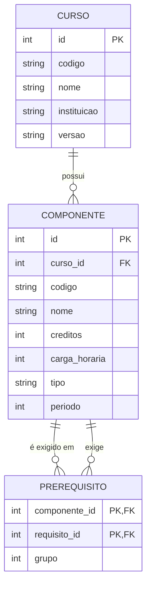
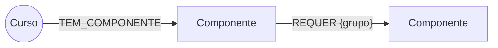

# Consulta da estrutura curricular do TADS (UFRN) — 3 bancos de dados

Mesmo currículo (TADS, estrutura 2019) modelado em **PostgreSQL**, **MongoDB** e **Neo4j**, com uma UI web que escolhe o banco, executa a consulta e mostra o resultado e o tempo.

## ⚠️ Antes de gravar o vídeo: conferir os dados

O PDF do SIGAA é um fluxograma. A extração de texto trouxe **código, nome e número ao lado de cada componente** (assumi que o número é crédito, 1 crédito = 15 h), mas **não trouxe as setas (pré-requisitos) nem as colunas (períodos)**. Também assumi que a 2ª página do PDF (a que tem TAD0201–TAD0205) é a de 2019.

- `data/tads_2019.json` → componentes e créditos vêm do PDF; `prerequisitos` é um **rascunho** (10 relações plausíveis) e `periodo` está vazio. **Conferir com as setas do PDF e corrigir o JSON antes de apresentar.**
- Depois de editar: `python seed.py` recarrega os três bancos.

## Como rodar

```bash
docker compose up -d                      # postgres, mongo e neo4j locais (mesma máquina = comparação justa)
python -m venv .venv && source .venv/bin/activate
pip install -r requirements.txt
python seed.py                            # valida o JSON e carrega nos 3 bancos
uvicorn app.main:app --reload             # http://localhost:8000
```

Consultas disponíveis na UI: buscar por nome/código (sem acento, parcial), pré-requisitos diretos, quem depende de um componente, e cadeia completa (transitiva) de pré-requisitos. O botão **Comparar os 3 bancos** roda 30 repetições (3 de aquecimento descartadas) e mostra média, mediana, mínimo e p95.

## 1. Modelos lógicos

### a) Relacional (PostgreSQL) — `app/schema_postgres.sql`



`UNIQUE(curso_id, codigo)` e `UNIQUE(codigo, versao)` garantem integridade. **E/OU** do fluxograma: requisitos com o **mesmo `grupo`** são alternativas (OU); **grupos diferentes** se combinam com E.

### b) Documentos (MongoDB) — coleção `componentes`, um documento por componente

```json
{
  "codigo": "TAD0029", "nome": "Arquitetura de Software", "creditos": 3, "carga_horaria": 45,
  "tipo": "obrigatoria", "periodo": null,
  "nome_busca": "arquitetura de software", "codigo_busca": "tad0029",
  "curso": { "codigo": "TADS", "nome": "Tecnologia em Análise e Desenvolvimento de Sistemas", "versao": "2019" },
  "prerequisitos": [ { "codigo": "TAD0004", "nome": "Análise e Projeto Orientado a Objetos", "creditos": 3, "grupo": 1 } ],
  "prereq_codigos": ["TAD0004"]
}
```

Decisão de modelagem: **pré-requisitos embutidos (desnormalizados)** → a consulta mais comum ("ficha do componente") é uma leitura de um único documento. O custo é duplicar nome/créditos dos requisitos (se um nome mudar, é preciso atualizar vários documentos). Cadeia transitiva usa `$graphLookup`; "quem depende de X" usa índice multikey em `prerequisitos.codigo`.

### c) Grafo (Neo4j)



Nós `Curso {codigo, nome, versao}` e `Componente {chave, codigo, nome, nome_busca, creditos, carga_horaria, tipo, periodo}`; aresta `REQUER` aponta do componente para o seu requisito. Cadeia completa = `MATCH (c)-[:REQUER*1..15]->(k)`.

## 2. Justificativa de cada banco

| Banco | Por que serve a este problema | Ponto fraco aqui |
|---|---|---|
| **PostgreSQL** | Dados são tabulares e fortemente relacionados; FK/UNIQUE/CHECK protegem a integridade (sem pré-requisito para código inexistente); `WITH RECURSIVE` resolve a cadeia transitiva. | Consultas de cadeia exigem SQL recursivo, mais verboso. |
| **MongoDB** | O acesso dominante é "mostre este componente com seus pré-requisitos" — documento único, sem JOIN; esquema flexível para cursos com campos extras. | Integridade referencial fica por conta da aplicação; duplicação de dados; travessia profunda é menos natural. |
| **Neo4j** | Pré-requisitos **são** um grafo; "cadeia", "caminho entre A e B" e "o que desbloqueia X" são travessias diretas e legíveis em Cypher. | Dado majoritariamente tabular não aproveita o grafo; mais um serviço para operar. |

## 3. Abordagem genérica (outro curso) e escolha final

**Formato neutro único** (`data/tads_2019.json`): `curso` + `componentes` + `prerequisitos`. Cadastrar outro curso = escrever um JSON no mesmo formato e rodar `python seed.py outro.json` (ou `POST /api/importar`). O importador **valida** código duplicado, referência inexistente, auto-requisito e **ciclos** antes de gravar, e todos os esquemas têm `curso` + `versão` como chave, então vários cursos/versões convivem no mesmo banco.

**Escolha final sugerida: PostgreSQL como banco principal.** Justificativa: (1) o domínio é estruturado e estável — componentes, créditos, relações; (2) a integridade (FK, unique, check) é o que mais importa ao cadastrar muitos cursos por pessoas diferentes; (3) a única necessidade "de grafo" (cadeia transitiva) é coberta por CTE recursiva sobre uma estrutura de poucas centenas de nós; (4) um só banco simplifica operação e backup. Neo4j passaria a valer a pena se surgissem consultas de caminho/impacto sobre milhares de componentes (várias universidades, equivalências entre currículos); MongoDB, se cada curso tivesse campos muito heterogêneos.

> **Cuidado ao interpretar os tempos:** com ~37 componentes, as diferenças de milissegundos refletem principalmente latência de driver/rede local e cache, não a qualidade do modelo. No vídeo, apresente os números **e** diga isso — a escolha deve se apoiar no encaixe do modelo ao problema. Se quiserem um teste com mais peso, gerem um currículo sintético grande (ex.: 5.000 componentes) no mesmo JSON e comparem de novo.

## 4. Checklist do vídeo (todos os membros aparecem)

1. Os três modelos lógicos (seções acima) e por que cada banco foi escolhido.
2. Os três bancos populados (Postgres via psql/DBeaver, Mongo via Compass, Neo4j Browser em `localhost:7474`).
3. UI: busca por nome ("banco"), por código, pré-requisitos, dependentes, cadeia — trocando o banco e mostrando o tempo.
4. "Comparar os 3 bancos" + a ressalva sobre o tamanho do dataset.
5. Demonstrar um **segundo curso** via `POST /api/importar` aparecendo no seletor de curso.
6. Escolha final e justificativa.
